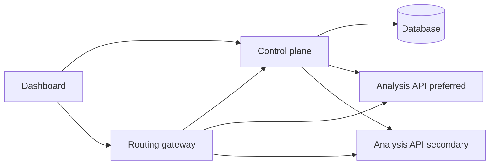

# CloudSentinel

CloudSentinel is a control centre for a containerised text-analysis service that can run in more than one place. When the copy that is supposed to serve traffic becomes unhealthy, the system records the failure, checks the other copy, and sends new requests there.

The engineering problem is operational, not cosmetic: detect a bad dependency, do not flap, and leave an incident trail that a person can read.

## Architecture



| Piece | Role |
| --- | --- |
| `apps/analysis-api` | FastAPI text analysis. Deterministic by default, optional OpenAI-compatible backend |
| `apps/control-plane` | Health probes, routing decisions, incidents, settings, experiments |
| `apps/routing-gateway` | Reverse proxy. This is the data plane |
| `apps/dashboard` | React console bound to the control-plane API |
| `kubernetes/` | Kustomize base plus local, Azure, and GCP overlays |
| `infrastructure/terraform/` | AKS and GKE modules. Not applied |

The gateway is one process. It is not DNS failover. If both analysis services are ineligible, the gateway returns 503. If the control plane is briefly down, the gateway may reuse a decision for 30 seconds and then fail closed. See [docs/decisions/0002-gateway-data-plane.md](docs/decisions/0002-gateway-data-plane.md).

Local environments named Azure and GCP are processes on this machine. They are not clusters. See [docs/decisions/0003-local-stand-ins.md](docs/decisions/0003-local-stand-ins.md).

## Technologies

| Choice | Why |
| --- | --- |
| Python 3.12, FastAPI, Pydantic | The analysis and control APIs, with typed requests |
| SQLAlchemy and Postgres | Control-plane state survives a process restart. Tests use SQLite so they do not need a database server |
| React, TypeScript, Vite, Tailwind | The console. Charts use Recharts and only render when samples exist |
| Kustomize | Small, reviewable differences between clusters. See ADR 0001 |
| Terraform azurerm 5.10 and google 8.7 | Current provider lines checked against the Terraform Registry in October 2026 |
| Prometheus text metrics | Already enough. OpenTelemetry is not deployed; the shared `X-Request-ID` is the correlation mechanism |

## Run it locally

Requirements: Python 3.12, Node 22, and optionally Docker.

```powershell
python -m venv .venv
.\.venv\Scripts\python -m pip install -e "apps/analysis-api[test]" -e "apps/control-plane[test]" -e "apps/routing-gateway"
$env:FAULT_INJECTION_ENABLED = "true"
$env:FAULT_TOKEN = "dev-fault-token"
$env:ENVIRONMENT_NAME = "azure-dev"
$env:ENVIRONMENT_PROVIDER = "azure"
.\.venv\Scripts\python -m uvicorn analysis_api.main:app --port 8001
```

In a second terminal, set `ENVIRONMENT_NAME=gcp-dev`, `ENVIRONMENT_PROVIDER=gcp`, and `--port 8002`.

In a third:

```powershell
$env:ADMIN_TOKEN = "dev-admin-token"
$env:READER_TOKEN = "dev-reader-token"
$env:GATEWAY_TOKEN = "dev-gateway-token"
$env:FAULT_TOKEN = "dev-fault-token"
$env:ANALYSIS_AZURE_URL = "http://127.0.0.1:8001"
$env:ANALYSIS_GCP_URL = "http://127.0.0.1:8002"
$env:DATABASE_URL = "sqlite+aiosqlite:///./data/control-plane.db"
New-Item -ItemType Directory -Force data | Out-Null
.\.venv\Scripts\python -m uvicorn cloudsentinel_control.main:app --port 8000
```

In a fourth window. The host port is 8081 because Windows often reserves 8080. Inside Docker and Kubernetes the process still listens on 8080.

```powershell
$env:CONTROL_PLANE_URL = "http://127.0.0.1:8000"
$env:GATEWAY_TOKEN = "dev-gateway-token"
.\.venv\Scripts\python -m uvicorn cloudsentinel_gateway.main:app --port 8081
```

Dashboard:

```powershell
cd apps/dashboard
npm install
npm run dev
```

Open `http://localhost:5173` and sign in with `dev-admin-token`. Those tokens are local placeholders from `.env.example`. Replace them before any shared deployment.

Docker Compose runs the same topology, including Postgres:

```powershell
docker compose up --build
```

The dashboard container listens on port 8088. Prometheus and Grafana are behind the `observability` profile: `docker compose --profile observability up`.

The monitor marks an environment eligible after two successful probes and moves traffic after three consecutive hard failures, or three slow responses. The default interval is 5 seconds. Give it a few seconds after startup before expecting a route.

Send a request:

```powershell
curl http://127.0.0.1:8081/api/v1/analyse -H "Content-Type: application/json" -d "{\"text\":\"The reliable cluster recovered after the failure.\"}"
```

The JSON `environment` field and the `X-CloudSentinel-Environment` header say which process answered.

## Tests

```powershell
.\.venv\Scripts\python -m pytest -q
cd apps/dashboard
npm run typecheck
npm run build
```

Details and the measured failover number are in [docs/testing/how-to-test.md](docs/testing/how-to-test.md).

## Terraform

Modules live in `infrastructure/terraform/modules`. Environments are `azure-dev` and `gcp-dev`. They use the local backend. Remote state is described in [docs/deployment/remote-state.md](docs/deployment/remote-state.md) and is not configured, so this repository cannot accidentally write to an existing state bucket.

```powershell
terraform fmt -check -recursive infrastructure/terraform
terraform -chdir=infrastructure/terraform/environments/azure-dev init -backend=false
terraform -chdir=infrastructure/terraform/environments/azure-dev validate
terraform -chdir=infrastructure/terraform/environments/gcp-dev init -backend=false
terraform -chdir=infrastructure/terraform/environments/gcp-dev validate
```

Validation is not a deployment. Cost, budgets, and destroy steps are in [docs/deployment/cost-and-cleanup.md](docs/deployment/cost-and-cleanup.md). Nothing in CI runs `terraform apply`.

Azure creates a resource group, a small VNet, an AKS Free-tier cluster with one node, Azure CNI overlay, a Basic registry, and a workload identity for the analysis service account. Monitoring is off unless you set `enable_monitoring`. GCP creates the required APIs, a custom VPC, a zonal GKE cluster, a separate node pool, Artifact Registry, and a workload-identity binding. The analysis service account has no project roles because the service does not call Google APIs.

## Kubernetes

```powershell
kubectl kustomize kubernetes/overlays/local
kubectl kustomize kubernetes/overlays/azure
kubectl kustomize kubernetes/overlays/gcp
```

The base deployment is non-root, drops capabilities, sets requests and limits, and has startup, readiness, and liveness probes. The PodDisruptionBudget uses `maxUnavailable: 1` because a single replica with `minAvailable: 1` cannot be drained. Cloud overlays turn fault injection off and expect you to replace the image and identity placeholders.

kind, if you want the cluster path:

```powershell
kind create cluster --name cloudsentinel
docker build -t cloudsentinel-analysis:local apps/analysis-api
docker build -t cloudsentinel-control-plane:local apps/control-plane
docker build -t cloudsentinel-gateway:local apps/routing-gateway
kind load docker-image cloudsentinel-analysis:local cloudsentinel-control-plane:local cloudsentinel-gateway:local --name cloudsentinel
kubectl apply -k kubernetes/overlays/local
```

kind's default CNI does not enforce NetworkPolicy. The policies are still in the manifests for clusters that do.

To watch a restart: `kubectl delete pod -n cloudsentinel -l app.kubernetes.io/name=analysis-azure`. The Deployment replaces the pod. That is Kubernetes restarting a container, not the control plane failing over. Failover is the gateway changing targets after the probe threshold.

## Failure recovery

Probes classify network errors, timeouts, application errors, readiness failures, and latency separately. One failure does not move traffic. The destination has to be eligible before the route changes. A cooldown then blocks another move until it expires, unless an admin calls `POST /api/v1/routing/recover`. Manual override refuses an environment that is not eligible.

State is in the database, so a control-plane restart during an incident keeps the route and the open incident. The reliability test covers preferred failure, both services down, slow responses, and that restart.

Experiments on the Reliability page are a fixed set: errors, latency, readiness, liveness, clear, and an optional pod restart. They do not accept a shell command.

## Security

See [docs/security/threat-model.md](docs/security/threat-model.md). Short version: tokens, least-privilege workload identities in Terraform, no credentials in the frontend, restricted pod defaults, and experiments limited to local or kind targets.

## Limitations

- The gateway and the control plane are single points of failure.
- Local Azure and GCP rows are labels. They have not been deployed to those clouds.
- HPA does nothing useful until a metrics server is installed. The object is still created.
- Schema changes are applied with `create_all` at startup. That is acceptable while this is one operator and one database. It is not a migration tool. Add Alembic before the first production schema change.
- OpenTelemetry is not running. Request IDs are.

## Possible later work

OIDC for users, a managed database, a second gateway, and a real AKS or GKE deployment after a budget alert exists. Those are planned. They are not done.

## Evidence

Interview notes and the commands that were actually run are in [docs/evidence/engineering-evidence.md](docs/evidence/engineering-evidence.md).
