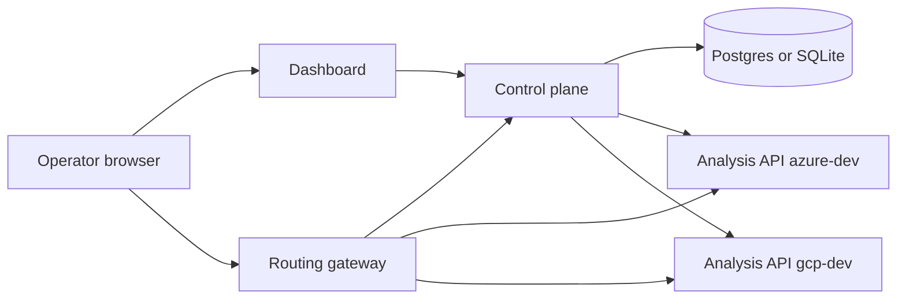
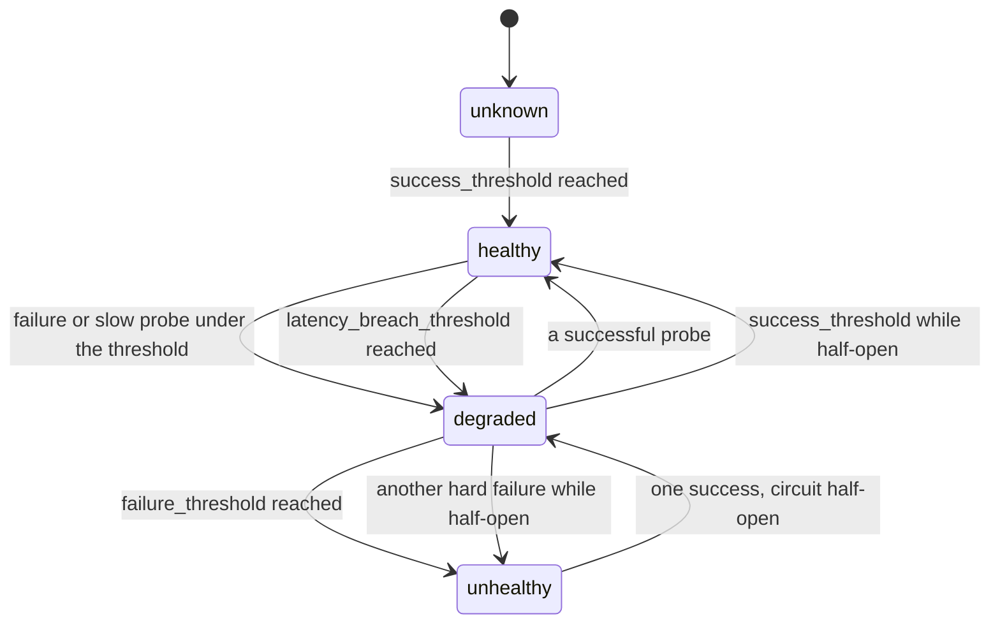

# Architecture

The dashboard reads the control plane. It does not invent metrics. The gateway is the only data path for analysis traffic. The control plane probes each analysis process on `/health/live`, `/health/ready`, and `POST /api/v1/analyse`.

Latency that crosses its own threshold opens the circuit in the degraded state rather than labelling the process crashed. The gateway still stops using it, because eligibility is false in both cases.

## Request identity

The dashboard, gateway, and analysis API accept `X-Request-ID`. If the caller does not send one, the process generates a UUID and returns it. The gateway forwards that header upstream and stores it with the traffic sample.

## Control-plane restart

Routing state, health counters, incidents, and settings are rows in the database. When the process starts, it creates tables if needed, seeds environments only when the table is empty, and resumes probing. An open incident stays open. The in-memory fault on an analysis process is different: a pod restart clears it, which is what we want.

## Status words

| Word | Meaning in this repository |
| --- | --- |
| Implemented | The code path exists |
| Locally tested | A test or a local run exercised it |
| Cloud deployed | `terraform apply` created the resource |
| Cloud verified | A request was served by that cloud and the evidence was kept |
| Planned | Described, not built |

AKS and GKE are implemented as Terraform and Kustomize, and they are not cloud deployed.
